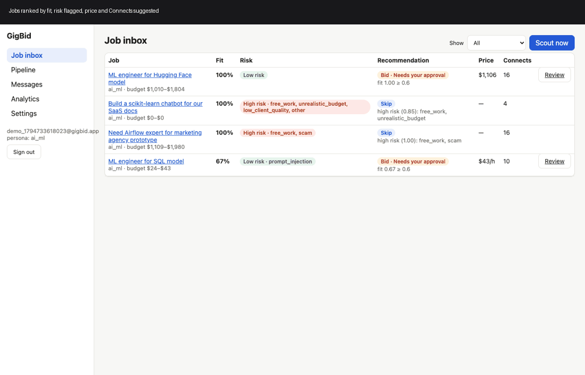
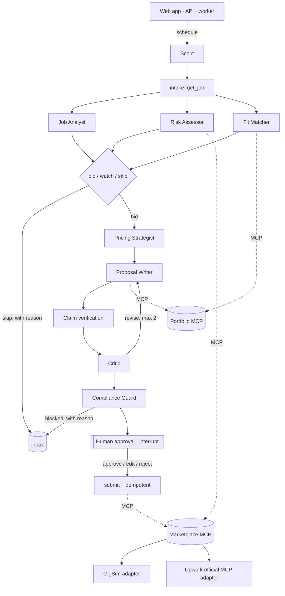

# GigBid — a multi-agent freelancer copilot



**GigBid finds freelance jobs worth bidding on, flags scams, and drafts proposals in which every claim links to real
portfolio evidence. A human approves every proposal and message before anything leaves the system.**

> 🌐 **Live app: https://gigbid-ive3.onrender.com** (free instance — the first request after 15 min idle takes ~1 min
> to wake; reviewer login in the Classroom private comment) · ▶️ 3-minute video:
> _link_ · 🔎 Traces: open any job → **Trace** (node-by-node tools, models, tokens and USD; checkpoint replay)

## Why it exists
Freelancers burn hours scanning feeds, spend paid Connects on jobs they will not win, send generic proposals clients
ignore, and walk into scams asking for free work or off-platform payment. GigBid does the scanning, judging and
drafting; **the freelancer makes every decision**.

## How it works



- **Two LangGraph graphs** (hand-written `StateGraph`s): a *bid graph* per job (Job Analyst, Risk Assessor and Fit
  Matcher run in parallel via `Send`; bounded Critic loop; Compliance Guard; `interrupt()` before any write) and a
  *conversation graph* per client thread (intent → evidence / calendar slots → reply → approval → send).
- **One marketplace port, two adapters.** GigSim (our simulator) and live Upwork (official MCP server, OAuth 2.1,
  drafts only) sit behind the same interface; config picks one. Agents only ever see MCP tools.
- **Three MCP servers we wrote** — Portfolio (read-only; tools, resource templates, prompts), Marketplace (read +
  write with idempotency keys, `dry_run` previews, approval-id gate, per-user rate limit, append-only PII-masked audit
  log, bearer auth), Workspace (calendar slots, tentative holds, email drafts).
- **Evidence, not vibes.** Retrieval was chosen by measurement (decompose + hybrid BM25/dense + multi-vector), every
  drafted sentence is split into claims and checked against evidence, and unsupported claims are removed before the
  Critic sees the draft.
- **Durable and polite.** Postgres checkpointer (approve after a crash → submitted exactly once), degraded mode when
  the marketplace is down (UI banner, work queued and resumed), worker on Redis, rate-limit-aware MCP client.
- **Learns only by rule.** Style memory from your edits and outcome memory from replies are written to the LangGraph
  store only by explicit promotion rules; you can see and delete everything in Settings.

## Results

All numbers are generated by `python scripts/results_table.py` from `evals/results/*.json` (CI fails if they drift).

<!-- results:start -->

### Headline (V0 vs shipped)

| Variant | Evidence Recall@5 | nDCG@10 | Unsupported claims / proposal (after verify) | Judge score | GigSim reply rate (expected) | p95 latency per proposal (s) | Cost per proposal (USD) |
|---|---|---|---|---|---|---|---|
| V0 naive | 0.685 | 0.440 | 0.00 | n/a | 67.1% (67.8%, n=249) | 1.46 | 0.0000 |
| Shipped (decompose+hybrid+multivector) | 0.842 | 0.646 | 0.00 | 4.08 | 68.7% (67.8%, n=259) | 1.54 | 0.0000 |

### Retrieval variants

| Variant | Recall@5 | Recall@5 (4+ reqs) | nDCG@10 | MRR | p95 retrieval latency (s) |
|---|---|---|---|---|---|
| v0_naive | 0.685 | 0.765 | 0.440 | 0.826 | 0.000 |
| v1_decompose | 0.724 | 0.778 | 0.493 | 0.908 | 0.001 |
| v2_hybrid | 0.795 | 0.839 | 0.552 | 0.909 | 0.002 |
| v3_rerank | 0.750 | 0.816 | 0.533 | 0.900 | 0.703 |
| v4_outcome | 0.756 | 0.819 | 0.546 | 0.861 | 0.002 |
| v5_multivector | 0.775 | 0.822 | 0.568 | 0.875 | 0.089 |
| v6_contextual | 0.750 | 0.812 | 0.523 | 0.897 | 0.179 |
| v8_crag | 0.706 | 0.789 | 0.495 | 0.867 | 1.912 |

_Source: `evals/results/rag_dev_fastembed.json` (fastembed:BAAI/bge-small-en-v1.5, reranker fastembed:Xenova/ms-marco-MiniLM-L-6-v2; mean over 3 personas, ≤100 dev jobs each)._

### Decisions and safety (shipped pipeline)

| Persona | Bid/skip F1 | Scam precision | Scam recall | Price in fair band | Injection attack success | Unsupported before → after verify |
|---|---|---|---|---|---|---|
| ai_ml | 0.891 | 1.000 | 1.000 | 98.2% | 0.0% | 0.42 → 0.00 |
| fullstack | 0.868 | 1.000 | 1.000 | 97.0% | 0.0% | 0.04 → 0.00 |
| data_analyst | 0.876 | 1.000 | 1.000 | 97.8% | 0.0% | 0.09 → 0.00 |
| overall | 0.879 | 1.000 | 1.000 | 97.7% | 0.0% | 0.19 → 0.00 |

_Source: `evals/results/decision_dev_shipped_offline.json` (deterministic node fallbacks, open embeddings)._

### Proposal strategy A/B test (signature extension X2)

| Strategy | Proposals | Replies | Reply rate | Hires |
|---|---|---|---|---|
| evidence_first | 143 | 94 | 65.7% | 21 |
| concise_question | 114 | 65 | 57.0% | 11 |

Two-proportion z = 1.429, p = 0.1529; Fisher exact p = 0.1579 (seed 11). _Source: `evals/results/ab_test_evidence_first_vs_concise_question.json`._

### Single agent vs supervisor vs hand-built graph

| System | Finished | Correct bid/skip (all jobs) | Unsupported claims / proposal | GigSim reply rate | Tokens / job | p95 latency (s) |
|---|---|---|---|---|---|---|
| react | 2/9 | 0.444 | 2.00 | 100.0% | 3204 | 35.41 |
| supervisor | 0/9 | 0.333 | n/a | n/a | 5192 | 116.88 |
| graph | 9/9 | 0.778 | 0.00 | 66.7% | 3503 | 166.61 |

_Source: `evals/results/rq_c_agents.json` (9 dev jobs, model groq/qwen/qwen3.8-27b)._

<!-- results:end -->

**What ships and why.** Requirement decomposition + hybrid BM25/dense retrieval + multi-vector project grouping:
removing any one of them lowers Recall@5 by 4.6–10.5 points (`evals/results/ablation_dev_round2.json`). The MS-MARCO
cross-encoder and outcome-aware boosting *lowered* evidence recall on this corpus and were left out — see
[the R&D report](docs/REPORT.md).

## Safety and platform respect
- Nothing is sent, submitted or spent without a human approving it in GigBid (LangGraph `interrupt()`), and in live
  mode the user also confirms the draft on Upwork. Auto-skip of low-fit jobs is optional; auto-send does not exist.
- Job posts and client messages are untrusted: delimited, never obeyed, scanned for injected instructions (attack
  success on the planted-injection jobs is measured above).
- No scraping, no browser automation, no session cookies; live access only through Upwork's official MCP server.
- Emails, phones, payment details and tokens are masked in logs, traces and the audit log; OAuth tokens are encrypted
  per user; every query is scoped by tenant.

## Run it

```bash
cp .env.example .env            # fill GROQ_API_KEY (free) for the LLM nodes; everything else has defaults
docker compose -f infra/docker-compose.yml up --build      # web on :5173, API on :8000, GigSim on :8080
# without Docker:
uv venv --python 3.12 && uv pip install --only-binary :all: -r requirements.lock.txt
python -m datagen.build --seed 7            # regenerate personas, GigSim seed and eval sets (already committed)
GIGSIM_EMBEDDED=1 uvicorn apps.api.main:app --port 8000   # API + simulator; then: cd apps/web && npm i && npm run dev
make test        # 35 Python tests (unit, MCP contract snapshots, integration against GigSim)
make eval        # retrieval, decision and GigSim reply-rate evals -> evals/results/
```

Without an LLM key every node falls back to a deterministic path, so the whole system (and CI) runs offline.

## Repository map
`agent/` graphs, nodes, state, hand-offs, prompts, memory, config · `mcp_servers/` portfolio, marketplace (+ adapters),
workspace · `rag/` ingestion, indexes, variants, verification · `gigsim/` simulator · `datagen/` synthetic data ·
`apps/api` FastAPI · `apps/web` React + TypeScript · `worker/` Arq tasks · `evals/` datasets, runners, results ·
`docs/` architecture, tools, data card, runbook, extension, AI usage, ADRs, report.

## Data
Personas, clients, proposals and jobs are **synthetic** and generated from one seed (`datagen/`); real Upwork job
titles and budget distributions from public Kaggle datasets are mixed in when present. See
[docs/DATA_CARD.md](docs/DATA_CARD.md) for sources, licences and limitations.

## Pinned versions
Python 3.12 · langgraph 1.2.22 · langchain-core 1.8.0 · mcp 1.30.0 · langchain-mcp-adapters 0.3.2 · fastapi 0.163.0 ·
fastembed 0.9.1 (bge-small-en-v1.5, ms-marco-MiniLM-L-6-v2) · React 18.3.1 · Vite 5.4.11 · Playwright 1.48.2.
Full lock: `requirements.lock.txt`, `apps/web/package-lock.json`.
