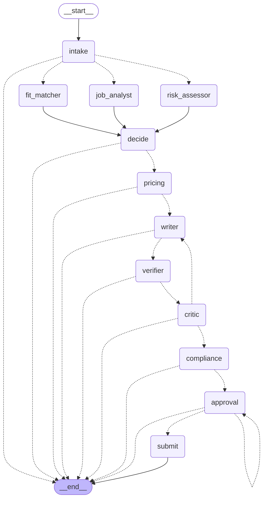
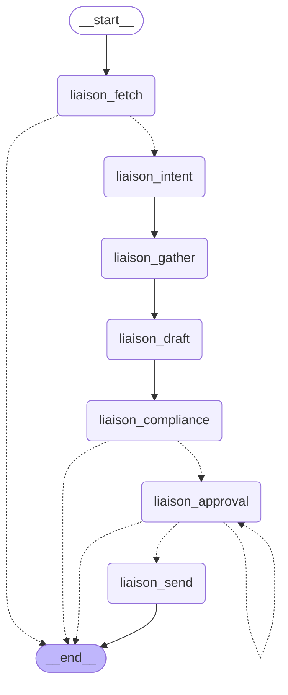

# Architecture

## Bid graph (one thread per job) — rendered from code (`python -m scripts.render_graphs`)

## Conversation graph (one thread per client conversation)

## Why each agent exists

| Node | Why it is a separate agent | Model / tools |
|---|---|---|
| **Intake / Scout** | Scheduling, dedup and polite polling are infrastructure, not reasoning; keeping them out of the graph means a worker restart never re-analyses a job (`seen_jobs` fingerprint + Arq job ids). | no LLM · `search_jobs`, `get_job` |
| **Job Analyst** | Produces the `JobSpec` every later step reads; isolating it lets the cheap model do extraction. | small model (fallback: bullet parser) · no tools |
| **Risk Assessor** | Safety must not depend on the writer's mood: deterministic rules first (scam, free work, off-platform, injection, client quality), LLM only *adds* flags and can never lower a rule-based one. | small model · `get_client_history` |
| **Fit Matcher** | Maps each requirement to evidence with a variant-independent similarity threshold, so "fit" is auditable per requirement. | no LLM · `search_evidence` |
| **Decide** | Pure rule over fit, risk and the user's floor, read from config — the change request lands here. | no LLM |
| **Pricing Strategist** | Market percentiles + client range + user floor + Connects expected value; deterministic and explainable. | no LLM · `get_market_stats`, `get_connects_balance` |
| **Proposal Writer** | Strongest model; sees only evidence (ids + text), gaps it must not claim, style rules and outcome insights. | strong model (fallback: case-study template) · `search_evidence`, `get_case_study` |
| **Verifier** (claim verification, B3) | Splits the draft into claims and grades each against evidence *before* the Critic, removing unsupported ones; records before/after counts. | strong model + lexical check · `search_evidence`, `get_case_study` |
| **Critic** | Grounding, personalisation, length, next step; sends back at most twice (`budgets.critic_max_revisions`). | strong model + rules |
| **Compliance Guard** | Policy pack as code: removes contact details/off-platform asks, rewrites guarantees, blocks fabricated claims with a reason shown in the UI. | no LLM |
| **Approval** | `interrupt()` with draft, per-claim evidence, risk, price rationale, critiques, compliance and the `dry_run` preview; approve / edit (re-checked, diffed into style memory) / reject with reason. | human |
| **Submit** | Two idempotent writes keyed by thread + draft version → exactly once across crashes and double clicks. | `create_proposal_draft`, `submit_proposal` |
| **Client Liaison** | Separate graph: intent (question / negotiation / interview / scam signal), evidence or calendar slots, reply, approval, send + tentative hold. | strong model (fallback: templates) · `list_messages`, `search_evidence`, `free_slots`, `send_message`, `create_interview_hold` |

## State, execution trace and long-term memory are kept apart
- **State** (`agent/state.py`): typed fields for job, analyses, evidence, decision, price, drafts, critiques,
  approvals and outcomes. Parallel branches write disjoint keys; accumulators have reducers.
- **Execution trace** (`trace`, append-only): every node, tool name, PII-masked arguments, result summary, latency,
  model, tokens and USD (`agent/nodes/base.py`). Also mirrored in the Marketplace audit log with the same trace id.
- **Long-term memory** (`agent/memory/`): only promoted knowledge in the LangGraph store — *style* (`style.repeat.v1`:
  an edit pattern seen in ≥3 approved edits across ≥2 jobs) and *outcome* (`outcome.lift.v1`: a proposal feature
  whose reply-rate lift is ≥10 points over ≥5 samples in a category). Raw tool output never goes there.

## The marketplace port
`agent/marketplace_port.py` defines one interface; `mcp_servers/marketplace/adapters/` implements it for GigSim (REST)
and live Upwork (official MCP over Streamable HTTP with per-user encrypted OAuth tokens; tool names mapped in
`config.yaml`). Switching is `MARKETPLACE_MODE=upwork` — the graph, prompts and UI do not change.

## Durability and failure handling
- Postgres checkpointer (`AsyncPostgresSaver`) in production, SQLite locally; thread ids `bid:<user>:<job>`.
- Kill the API while a proposal waits: the interrupt is in the checkpoint; approving after restart resumes the
  thread and the idempotency keys make the submission exactly-once (`tests/integration/test_bid_graph.py`).
- Marketplace down → `MarketplaceDown` propagates, the failed node stays pending in the checkpoint, the UI shows
  the banner, and `retry_bid` resumes exactly that node later.
- Step budget (40) and token budget (60k) per thread → `needs_attention`; non-transient errors → `dead_letter` with
  the reason; cheap nodes fall back to a second model.
- Any checkpoint can be replayed from the UI (`/runs/<thread>` → *Replay from here*).

## Deployment shapes
- `docker compose up`: every MCP server, GigSim, API, worker, web, Postgres (pgvector), Redis, optional Ollama.
- Single container for free hosts (`infra/docker/app.Dockerfile`): API + built UI + embedded GigSim + inline worker,
  MCP over the in-memory transport (same protocol, same servers, no network hop).
